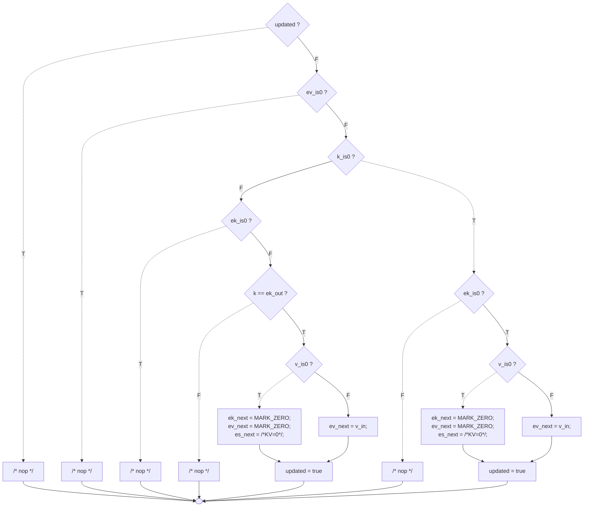
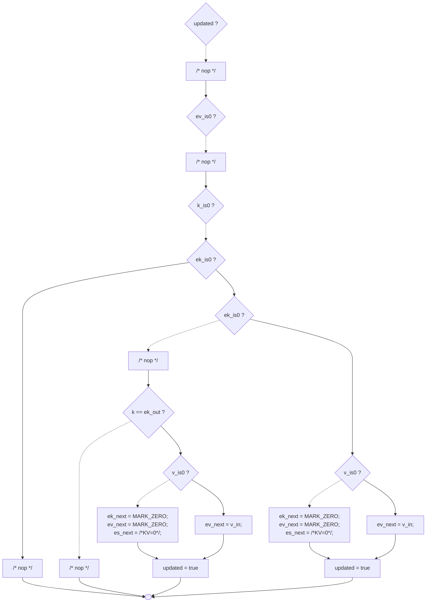

# Constant-Gas Programming

Anonymous Submission

This Markdown transcription follows the LaTeX source for section and figure placement, with the PDF used as a rendering/reference check. Where the LaTeX source and PDF front matter differ slightly, the LaTeX text is kept and the PDF-only variant is noted explicitly.

## Abstract

The intricacies in EVM storage gas metering accidentally reveal a flaw in the constant-time programming principle: the ability for an attacker to discern whether a memory update writes back the same value or a different value (without revealing the values).

With this ability, an attacker might compromise the confidentiality of a constant-time Solidity contract running inside a TEE-based runtime on a privacy-preserving blockchain.

In this paper, we present constant-gas programming to strengthen the threat model and provide building blocks for manual development of constant-gas Solidity as well as a compiler pass for semi-automated transformation of Solidity programs into constant-gas versions.

## 1. Introduction

Timing attack is a side-channel attack (SCA) that poses a serious threat to otherwise perfectly secure software.

Such attacks allow adversaries to gain information about secret values by monitoring the executions of a victim program for changes in any observable channels, such as microarchitectural states (e.g., cache eviction [30] or branch misprediction [14]), memory and filesystem accesses [27, 13], or even in the simplest form---total execution time [19].

Timing-based SCAs have been well studied especially on cryptographic implementations [6, 5, 7] due to both their importance and the unambiguously marked secret data--- cryptographic keys and plaintexts [16].

As a countermeasure, security practitioners often mitigate timing attacks via a principle named *constant-time programming*.

Informally, a program is said to be constant-time if it always (1) executes the same instructions and (2) accesses the same sequence of memory addresses, independent of its secret inputs [23].

Due to its effectiveness against strong adversary models [8], constant-time has become an essential property in any modern cryptographic implementations.

On the first look, constant-time programming is at odds with smart contracts which often execute on public blockchains on which transaction details, such as code executed, transaction arguments, and effects of the execution (i.e., changes to on-chain data) are all revealed in the open [3].

However, as privacy-preserving blockchains start to gain traction [9], their focus on protecting the confidentiality of transaction and on-chain data while still maintaining transparency and immutability calls for awareness of information leaks via side-channels.

Unfortunately, not all privacy-preserving schemes are inherently immune to side-channels.

Existing privacy-preserving blockchains that support smart contracts generally fall into three technical families:

- Zero-knowledge-proof (ZKP) systems (e.g., [Aleo](https://aleo.org/), [Aztec](https://aztec.network/)) publish succinct SNARK/STARK proofs that attest to encrypted state transitions without revealing transaction details;
- Fully homomorphic encryption (FHE) or multi-party computation (MPC) (e.g., [Partisia](https://partisiablockchain.com/), [Findora](https://mainnet.findora.org/)) compute over ciphertexts, with on-chain states and transaction details encrypted at all times;
- Trusted execution environment (TEE)-based confidential runtimes (e.g., [Oasis Sapphire](https://oasis.net/sapphire), [Secret Network](https://scrt.network/)) store encrypted on-chain states publicly and only reveal transaction details and storage data in plaintext inside attested hardware (e.g., Intel SGX) that are trusted by the users such that computation can be performed at near-native speed.

Compared with ZKP- and FHE/MPC-based blockchains, TEE-based solutions are currently in the leading position in adoption likely due to their efficiency of execution, compatibility with existing smart contract software stack (e.g., compilers, virtual machines, libraries, etc) and the fact that TEE hardware is commonly available on most if not all major cloud service providers.

However, while TEE protects the confidentiality of data via isolation in runtime enclaves [12], commercial TEE implementations offer limited resistance to side-channel attacks.

Therefore, there has always been a theoretical possibility of information leaks on confidential computing platforms [17, 28, 31] despite the wide adoption of TEEs in practice.

As a result, how to achieve confidential execution of smart contracts even in the presence of various forms of side-channels remains a research question.

This work addresses this question by proposing a software-only methodology to improve side-channel resistense of TEE-based privacy-preserving blockchains: *constant-gas programming*.

In essence, constant-gas programming is derived based on the constant-time programming principle with an extended notion of "memory" to include on-chain storage and a stronger adversary model that additionally enables attackers to tell whether there are changes in a memory slot when it is written back (Section 2).

We call it constant-gas as in the realm of smart contracts, instruction execution and memory/storage accesses are both reflected in gas cost.

However, a blockchain that trivially charges the same gas amount regardless of how it executes the transaction is *not* the way towards constant-gas programming and will leak information under our adversary model (Section 3).

To showcase how constant-gas programming can be properly achieved, we prototype the principle on Solidity, the most popular language for smart contracts.

Our prototype consists of:

(1) A set of constant-gas primitives in Solidity (Section 4), including 1) a constant-gas ternary `select` operator,

2) implementations of fixed-size primitive types in storage (e.g., `uint256`, `bytes32`), and

3) implementations of `mapping` types with fixed-size values in storage (e.g., `mapping(bytes32 => uint256)`).

These primitives are essential for automated compile-gas program transformation and can also be used in manually written constant-gas programs.

(2) A semi-automated Solidity compiler pass (Section 5) that transforms a Solidity program not intended for constant-gas execution into a constant-gas form via primarily control-flow linearization (CFL) [23].

However, while CFL is fully automated, the compiler still requires manual annotations for loop bounds and for pre-allocating data structures,

although both can be automated in the future.

Although a constant-gas program is expected to consume more gas than its efficient counterpart, the actual overhead is decided by the complexity and logic of the program.

Our evaluation (Section 6) might shed some light on the scale of overhead to expect, which is also the price of side-channel resistance in TEEs:

- The constant-gas `select` operator only incurs a moderate gas overhead between 13% - 28% on primitive fixed-length types (e.g., `u8`, `u64`, `u256`);
- The average gas cost is 6.5x for read and 2x for write for operating on constant-gas versions of primitive types that are persisted as on-chain states;
- The constant-gas versions of `mapping` type are extremely expensive, with up to 80x, 600x, 2400x for reading and 50x, 300x, 1100x for writing, with capacity of 8, 64, 256 entries, respectively.

## 2. From Constant-Time to Constant-Gas

In this section, we show how constant-time Solidity looks like, and discuss why constant-gas is a stronger model against information leaks via side-channels.

### 2.1. Constant-Time Solidity

Constant-time programming firstly requires that the execution paths of a program do not depend on secrets.

On its own, this requirement is roughly equivalent to security in the program counter (PC) model [21] in which PC values do not depend on secrets.

However, this requirement is not strong enough to defend against cache-timing attacks or microarchitectural side-channels.

Hence the second aspect of constant-time programming requires that the sequence of accessed memory addresses at runtime do not depend on secrets.

A constant-time program is allowed to have code/memory accesses dependent on public information though.

While a Solidity program rarely compiles to CPU instructions,

we can use the Ethereum Virtual Machine (EVM) bytecode to approximate CPU instructions and access to memory-alike objects, such as reference types annotated with `memory`, `storage`, and in the future, `transient`, as accesses to memories.

We hence re-establish constant-time programming of Solidity from the EVM perspective:

**Definition.** Assuming an attacker can obtain: (1) full sequence of EVM opcode (without operands) executed (denoted as $I$), (2) full sequence of memory slots (without contents) accessed (denoted as $M$), and

(3) $I$ and $M$ interleaved in the execution order ($I+M$).

A constant-time Solidity program should reveal absolutely no information about the secrets used in the execution of the program.

Left panel.

```solidity
contract Authentication {
 bytes32[256] public TOKENS;
 constructor() {
  TOKENS[0]   = 0x1c8aff950685c2ed...;
  /* .. TOKENS has no duplications */
  TOKENS[255] = 0x4f5b812789fc606b...;
 }

 function iFmF(uint token) returns (uint) {
  bytes32 h = keccak256(abi.encode(token));
  for (uint i = 0; i < TOKENS.length; i++) {
   if (TOKENS[i] == h) { return 1; }
  }
  return 0;
 }

 function iFmT(uint token) returns (uint) {
  bytes32 h = keccak256(abi.encode(token));
  uint r = 0;
  for (uint i = 0; i < TOKENS.length; i++) {
   if (TOKENS[i] == h) { r = 1; }
  }
  return r;
 }
```

Right panel.

```solidity
 function iTmF(uint token) returns (uint) {
  bytes32 h = keccak256(abi.encode(token));
  uint r = 0;
  for (uint i = 0; i < TOKENS.length; i++) {
   bytes32 e = TOKENS[i];
   uint t = 1;
   for (uint j = 0; j < 32; j++) {
    t &= TOKENS[uint8(e[j])]
         == TOKENS[uint8(h[j])] ? 1 : 0;
   }
   r |= t;
  }
  return r;
 }

 function iTmT(uint token) returns (uint) {
  bytes32 h = keccak256(abi.encode(token));
  uint r = 0;
  for (uint i = 0; i < TOKENS.length; i++) {
   r |= (TOKENS[i] == h) ? 1 : 0;
  }
  return r;
 }
} /* end of contract */
```

*Figure 1. Four implementations of the same functionality: all `i[T|F]m[T|F]` functions should return `1` if the user can provide a secret value whose hash matches one of pre-defined `TOKENS` and `0` otherwise.*

Figure 1 is a conventional example illustrating how the same functionality can be implemented in different ways that can defend against inference attacks through $I$, $M$, or $I+M$.

In particular, `iFmF` is the weakest as an attacker can determine which `TOKEN` the hash of the secret `token` matches to by examining either $I$ or $M$ alone,

while `iTmT` is the strongest as regardless of what the secret `token` value is, the same instructions are executed and the same memory slots (in fact, all elements in `TOKEN`) are accessed in the same order.

Note, however, that both `iTmF` and `iTmT` assume the ternary operator yields the same EVM bytecode sequence, which is not true as of Solidity 0.8.31.

We provide a constant-time (also constant-gas) implementation of the ternary operator in Section 4.

### 2.2. Insights Behind Gas Metering on Storage

While it is tempting to believe that a constant-time Solidity program always yields the same gas cost regardless of the secret input, this is unfortunately not true.

Figure 2 shows a slightly modified `Authentication` contract that is constant-time but the `iTmT` function yields different gas cost depending on the secret `token`.

More specifically, (1) if the `_last_auth_token` on-chain state is zero, a valid `token` (hence a successful authentication) costs 19,900 more units of gas compared with an invalid `token`, as the on-chain state changes from zero to a non-zero byte;

(2) if the `_last_auth_token` on-chain state does not change (e.g., authenticating with the same token), the transaction consumes 2,800 units of gas less compared with authenticating with a different token.

In both cases, an attacker can extract some information about the `token` used via the gas cost only.

Left panel.

```solidity
contract Authentication2 {
 bytes32[256] public TOKENS;
 uint8 private _last_auth_token = 0;

 constructor() {
  TOKENS[0]   = 0x0; // intentional
  TOKENS[1]   = 0x8452c9b9140222b0...;
  /* TOKENS has no duplications */
  TOKENS[255] = 0x4f5b812789fc606b...;
 }
```

Right panel.

```solidity
 function iTmT(uint token) returns (bool) {
  bytes32 h = keccak256(abi.encode(token));
  uint8 r = 0;
  for (uint8 i = 0; i < TOKENS.length; i++) {
   r |= (TOKENS[i] == h) ? i : 0;
  }
  _last_auth_token = r;
  return r != 0;
 }
} /* end of contract */
```

*Figure 2. A constant-time but not constant-gas Solidity program*

Although this seems like nitty-gritty details of gas metering in EVM, these intricacies reveal a loophole that has been overlooked in the constant-time definition---the ability for adversaries to discern changes in memory content without direct access to the content---and this is not impossible through side-channels [22, 11, 26]!

To reiterate, conventional constant-time programming assumes an attacker knows the memory addresses accessed and whether the access is a read or write, but forbids the attacker to know whether the memory content is changed in any way.

However, in EVM, the on-chain storage gas metering reveals some information about its content and how it is updated.

More specifically, the gas cost is different depending on whether the slot is warm or cold when accessed and, more importantly, in case of a write-back, whether the content of the storage slot (1) is set (i.e., from zero to non-zero), (2) is cleared (i.e., from non-zero to zero), (3) remains the same, or (4) is updated to another non-zero value.

Therefore, to achieve constant-gas programming, we assume that an attacker can differentiate these four cases of on-chain storage slot update, and strengthen the memory sequence $M$ obtainable by the attacker in the constant-time definition (Section 2.1) into *full sequence of memory slots accessed, including whether and how the slot content has changed in one of the four ways*, denoted as $M^+$.

Effectively, this means that the constant-gas notion is stronger than constant-time.

**Other intricacies.** The foundation of constant-gas is that on EVM, gas metering is *consistent* for a majority of instruction types, i.e., the same amount of gas is charged for the same opcode, regardless of its operands.

The exceptions are operations related to storage (already discussed), memory, logging, code deployment, and indirect calls.

As constant-gas programming requires the availability of all code that can potentially be executed to be available at compile-time (see Section A.3 for details of this limitation), gas costs related to code deployment and indirect calls are not relevant.

We also avoid memory expansion cost [2] by strictly enforcing the use of constant-sized arrays whose sizes are determined at compile-time (e.g., by manual annotations) and avoid variable logging costs by skipping logging entirely, as logging is generally discouraged in privacy-preserving practices.

## 3. Real-world Implications

Constant-gas programming has real-world implications on TEE-based privacy-preserving blockchains.

We use Figure 3 to illustrate how TEE-based privacy-preserving blockchains can help improve the privacy of participants by making transaction data and on-chain storage confidential,

and later in Section 3.1, how this non-constant-gas contract can leak information.

Left panel.

```solidity
contract Mixer {
 mapping(bytes32=>uint256) private balances;

 function deposit
 (bytes32 commit, uint256 amount) external {
  balances[commit] += amount;
 }
```

Right panel.

```solidity
 function withdraw
 (bytes32 secret, uint256 amount) external {
  bytes32 commit = keccak256(abi.encode(secret));
  require(balances[commit] != 0);
  balances[commit] -= amount;
 }
} /* end of contract */
```

*Figure 3. A simplified implementation of a mixer contract.*

With the intention of hiding the linkage between senders and recipients of balances,

the `Mixer` contract is, however, obviously not intended for deployment on a public chain as all transactions to this contract are visible and hence, anyone obtaining the transaction history can link addresses making `deposit` to hash `commit` and addresses taking `withdraw` from `keccak256(secret) = commit`, hence partially defeating the purpose of `Mixer`.

Instead, the `Mixer` contract is expected to be deployed on a TEE-based blockchain.

A user sends encrypted transaction to the TEE, while the TEE decrypts and executes the logic inside its hardware enclave which provides strong isolation even against compromised operating systems.

When the transaction finishes, the transaction details are published on chain but in encrypted form therefore, an attacker, without compromising the TEE, cannot reveal the plaintext of any `secret` or `commit` in the transaction history, which prevents address linking via `keccak256(secret) = commit`.

### 3.1. Threat Model

While TEE guarantees the confidentiality of `secret` and `commit` in Figure 3, it does not rule out address linking via side-channels under a powerful adversary model typically assumed in side-channel attacks against TEE implementation.

In particular, we assume that:

- The TEE hardware enclave is trusted in providing isolation in confidential computing. The attacker cannot see the encrypted transaction details nor the content of the storage (i.e., on-chain state) in plaintext as these information is only decrypted inside the enclave. The attacker cannot obtain CPU register values nor memory content when execution is in the enclave.
- The attacker, however, can obtain the traces of addresses by a program in the instruction and data cache, and has full visibility to the disk/network IO activities (e.g., by compromising the hosting operating system of the TEE stack). Using these information, the attacker can fully construct $I+M^+$ (Section 2.2) for any smart contract executed by the EVM inside TEE.

We additionally assume that the EVM implementation in the TEE does not leak information via the CPU instruction sequence it executed, i.e., every EVM bytecode translates to the same trace of CPU instructions regardless of the operands of the bytecode when executed on the native CPU.

However, we do not assume the instructions lead to the same memory access pattern,

instead, we assume that accessing the same storage slot in EVM leads to the same set of memory accesses in the TEE.

This is unlikely to be true for any stock EVM implementation, but implementing such an EVM

is not infeasible either.

**Implications.** With this threat model, in the `Mixer` contract presented in Figure 3, an attacker can infer a variety of information about both secret deposits and secret withdraws, such as pairing withdraws and deposits by observing that they access the same `balances[commit]` slot in the global storage.

This effectively defeats the purpose of `Mixer` in this the privacy-preserving setting despite that the TEE-based execution does not reveal the plaintext of `secret` and `commit`.

Other information can be inferred under this threat model include whether withdraw is successful and even why it fails.

**Convenience assumptions.** We also make some convenience assumptions about what is typically encrypted in a TEE-based privacy-preserving blockchain.

However, these are not hard assumptions and if the blockchain does not support it, we can trivially implement it in our constant-gas toolkit.

- Every slot in storage, when encrypted, is individually salted. Therefore, equality among two slots do not reveal any information. If this is not true, we can additionally store a randomly generated `XOR` mask for each slot a constant-gas contract writes to. We do not require the salts to be periodically changed.
- Although transaction arguments are encrypted, we assume attackers can know which entrypoint is called in the transaction. We can additionally hide this information by wrapping all possible entrypoints into a dummy `main` with a switch-case and apply constant-gas transformation (Section 5) to that `main` function.

## 4. Constant-Gas Primitives

Constant-gas programming requires no secret-dependent control-flow structures.

However, conditional assignment of variables is crucial in any useful programming.

Therefore, a constant-gas version of `select(predicate, true_value, false_value)` is the building block of more complicated programs.

**Conditional select.** While Solidity has a built-in ternary operator in the syntax of `predicate` `?` `true_value` `:` `false_value`, the resulting EVM bytecode is unfortunately not constant-gas as it is lowered to a `switch` instruction with `case-0` and `default` blocks while only one block will be executed.

```solidity
function cg_select_u256(bool cond, uint256 t, uint256 f) public pure returns (uint256 r) {
  uint8 v; uint256 m; assembly { /* executed left-to-right, top-to-bottom */
    v := iszero(cond);  v := shl(7, v);     m := signextend(0, v);      m := sar(8, m);
    r := xor(t, f);     r := and(m, r);     r := xor(r, t);
}}
```

*Figure 4. Implementation of constant-gas conditional select*

Figure 4 shows a constant-gas implementation of conditional select written in Yul assembly (which is closer to the EVM bytecode) that does not reveal whether the predicate `cond` is true or false by the sequence of executions executed.

The implementation makes heavy use of bitwise operations to avoid control-flow transitions.

The implementation of conditional select for other fixed-length data types (e.g., `u8`, `u64`, etc) in Solidity is in principle the same as Figure 4.

**Primitive type in storage.** On-chain storage is an integral component for any useful Solidity contract, after all, storage is where the state of the program is persisted on-chain.

However, for most data types, getting or setting a variable of the type in storage in verbatim rarely satisfies the constant-gas requirement.

For example, in the `VerbatimU256` contract shown in Figure 5, an attacker can infer whether the secret `value` passed to the `set` function is zero or not simply by monitoring the gas cost.

Similarly, the attacker might also infer whether the `value` set in this transaction is the same as the last `value` set.

This necessitates the development of a constant-gas version of `uint256` that is suitable to be used as a variable in on-chain storage.

The implementation of such a `uint256` type, named `CGU256`, is presented in Figure 5.

As evident by the code, this implementation is remarkably more complicated than the verbatim `uint256`.

Notably, the implementation of `CGU256` follows three empirical guidelines which help to reason about the constant-gas property of a program:

Left panel.

```solidity
contract VerbatimU256 {
 uint256 private v;
 function get() public view returns (uint256) {
  return v;
 }
 function set(uint256 value) public {
  v = value;
 }
}
```

```solidity
contract CGU256 {
 uint256 public constant MARK_ZERO = 0xFF..FF;
 uint8 public constant STATUS_BASE = 1;
 uint8 public constant STATUS_BIT_IS_ZERO = 1;

 uint256 private version;
 mapping(uint256 => uint256) private record;
 mapping(uint256 => uint256) private status;

 constructor(uint256 value) { set(value); }
```

Right panel.

```solidity
 function get() public view returns (uint256) {
  return cg_select_u256(
   u256_is_bit_set(status[version],
                   STATUS_BIT_IS_ZERO),
   0, record[version]
  );
 }

 function set(uint256 value) public {
  bool is_zero = (value == 0);
  version += 1;
  record[version] = cg_select_u256(
   is_zero, MARK_ZERO, value
  );
  status[version] = cg_select_u8(
   is_zero,
   u8_set_bit(STATUS_BASE, STATUS_BIT_IS_ZERO),
   STATUS_BASE);
 }
} /* end of CGU256 contract */
```

*Figure 5. Implementation of constant-gas `uint256` and verbatim `uint256` in storage*

*Guideline 1:*$ $ Avoid writing a zero value to any storage slot (which can be recognized under our threat model), instead, to represent a zero, store a non-zero (`MARK_ZERO`) alongside a status value with a special bit set to indicate that the `MARK_ZERO` should be discarded when the bit is set (e.g., the `get` function).

*Guideline 2:*$ $ Avoid reusing the same storage slot and any new value, including zero, should always be set in a new slot.

In the `CGU256` implementation, this is achieved with a monotonically increasing `version` variable which serves as the index in the `record` and `status` mapping.

Every time a new `value` is set, the `version` is incremented, forcing the `value` to be put into a new storage slot in `record` (and a new `status` too) even when `value` is the same as the old value.

In this way,

we break the attacker's ability of inferring whether a new `value` is set via gas cost, which essentially represents attackers' ability on observing state changes of the old storage slot.

*Guideline 3:*$ $ Always initialize the slot to a non-zero value even at construction time.

Leaving a default zero value in the slot opens the door for attackers to infer when this slot is first set by monitoring a zero to non-zero change which is also reflected in gas cost as well.

**Mapping type in storage.** The `mapping` type is a powerful feature in Solidity.

Conceptually, it can be viewed as hash tables which are virtually initialized such that every possible key exists and is mapped to a default value: all-zeros.

Because of this, `mappings` do not have lengths, cannot be iterated on their own, and do not explicitly distinguish whether a key or a value is stored in the `mapping`--- although zero-ing a value indexed by its key is often considered as erasing a (key, value) pair in the `mapping` at least from the perspective of a refund of storage gas.

Left panel.

```solidity
contract VerbatimMapU256ToU256 {
 mapping(uint256 => uint256) private table;
 function get(uint256 key)
 public view returns (uint256) {
  return table[key];
 }
 function set(uint256 key, uint256 value)
 public {
  table[key] = value;
 }
}
```

```solidity
contract CGMapU256ToU256 {
 uint256 public constant MARK_ZERO = 0xF..F;
 uint8 public constant STATUS_BASE = 1;
 uint8 public constant STATUS_BIT_K_IS_ZERO = 1;
 uint8 public constant STATUS_BIT_V_IS_ZERO = 2;

 struct Entry {
  mapping(uint256 => uint256) key;
  mapping(uint256 => uint256) value;
  mapping(uint256 => uint8) status;
 }
```

Right panel.

```solidity
 /* on-chain states of CGMapU256ToU256 */
 uint16 public immutable CAPACITY;
 Entry[] private entries;
 uint256 private version;

 constructor(uint16 capacity) {
  version = 1;
  for (uint16 i = 0; i < capacity; i++) {
   entries.push();
   Entry storage entry = entries[i];
   entry.key[version] = MARK_ZERO;
   entry.value[version] = MARK_ZERO;
   entry.status[version] = u8_set_bit(
    u8_set_bit(STATUS_BASE,
               STATUS_BIT_K_IS_ZERO),
    STATUS_BIT_V_IS_ZERO
   );
  }
  CAPACITY = capacity;
 }
 // get function shown in Figure 7
 // set function shown in Figure 10
} /* end of CGMapU256ToU256 contract */
```

*Figure 6. Structural definition and constructor of the constant-gas equivalent of `mapping(uint256 => uint256)` in storage, presented alongside the verbatim `mapping(uint256 => uint256)` as contrast*

However, the characteristics of `mapping` also bring tremendous complexity in using a `mapping` in global storage in a constant-gas way.

For example, the unbounded nature of a `mapping` goes naturally against *Guideline 3* listed above as it is practically impossible to initialize the slots indexed by all possible keys of a `mapping` with a non-zero value.

As a consequence of the unbounded nature of a `mapping`, in the verbatim code shown in Figure 6, if the `table` variable is left uninitialized, an attacker can infer when a `key` in the `table` is initially set, or whether two executions of the `set` operation target the same `key`, even when `key` and `value` are never revealed in plaintext.

This necessitates the development of a constant-gas version of `mapping` types that is suitable to serve as the on-chain storage in constant-gas programs.

The implementation of such a `mapping` type, as examplified in `CGMapU256ToU256` which aims to simulate `mapping(uint256 => uint256)`, is too complicated to be presented in a single figure.

Instead, the structural definition and the constructor is shown in Figure 6, while the getter and setter functions are shown in Figure 7 and Figure 10, respectively.

However, unlike the `CGU256` implementation which fully preserves the semantics of a `uint256` in storage, `CGMapU256ToU256` has to make an important but necessary compromise---bounding the number of (key, *non-zero* value) pairs that can be recorded in the `mapping` (`CGMapU256ToU256` can hold an unlimited number of (key, *zero*-value) pairs though).

This is evident by the `CAPACITY` field in Figure 6 as well as the pre-allocation and initialization of the `entries` array in the constructor.

And yet, even with size-bounding, the `CGMap` series (including `CGMapU256ToU256`) is still different from hash tables commonly found in other programming languages, such as `dict` in Python or a `HashMap` in Java.

Like the `mapping` type, a `CGMap` does not explicitly differentiate whether a key does not exist or a key exists with value equals to zero.

Effectively, the bounding only enables iteration over all (key, *non-zero* value) pairs in the `CGMap`.

This iterable property is important in ensuring that no information about the key used to access the `CGMap` can be inferred via the memory access trace ($M^+$), as reflected in the implementation of the `get` function in Figure 7.

Left panel.

```solidity
function get(uint256 key) public view
returns (uint256 r) {
  r = 0;
  bool k_is0 = (key == 0);

  for (uint16 i = 0; i < CAPACITY; i++) {
    Entry storage entry = entries[i];
    uint256 ek = entry.key[version];
    uint256 ev = entry.value[version];
    uint8 es = entry.status[version];

    bool ek_is0 = u8_is_bit_set(
      es, STATUS_BIT_K_IS_ZERO
    );
    uint256 ek_out = cg_select_u256(
      ek_is0, 0, ek
    );

    bool ev_is0 = u8_is_bit_set(
      es, STATUS_BIT_V_IS_ZERO
    );
    uint256 ev_out = cg_select_u256(
      ev_is0, 0, ev
    );
```

Right panel.

```solidity
    r = cg_select_u256(ev_is0,
      // value = 0 means entry is empty, continue
      r,
      cg_select_u256(k_is0,
        cg_select_u256(ek_is0,
          // key == 0 == entry_key, return value
          ev_out,
          // key == 0 != entry_key, continue
          r
        ),
        cg_select_u256(ek_is0,
          // key != 0 == entry_key, continue
          r,
          cg_select_u256(key == ek_out,
            // key == entry_key != 0, return value
            ev_out,
            // key != entry_key != 0, continue
            r
          )
        )
      )
    );
  } /* end of the for loop */
} /* end of the get function */
```

*Figure 7. Implementation of a constant-gas `get` for `CGMapU256ToU256` in storage*

*Guideline 4:*$ $ Access all memory locations when the key is a secret.

This idea has been shown in the `auth_iTmT` function in Figure 1: even with the full memory access trace $M^+$, an attacker cannot infer which item in the `TOKENS` list matches with the secret input because all elements in the `TOKENS` are visited in a deterministic order, regardless of the secret input.

Similarly, in the implementation of `CGMap`, this guideline means that accessing any key requires an iteration of all entries in the mapping in a deterministic order, which is exactly how the `get` function is implemented (details in Figure 7).

Another implication of this guideline is the requirement to size-bound any unbounded data structure using public information only.

In the case of `CGMap`, it means that the `CAPACITY` argument used in its constructor cannot depend on a secret (shown in the right panel in Figure 6).

We defer the discussion of the `set` function of `CGMap` (Figure 10) to Section 5 as it is a perfect example to show how to mechanically translate a complex control-flow graph (CFG) into a constant-gas form.

## 5. Control-Flow Linearization

While primitives in Section 4 enable manual development of constant-gas Solidity programs,

such a practice can be tedious and error prone, and often requires a standalone verifier to check whether the manually written code is indeed constant-gas.

In light of this, we develop a Solidity compiler pass that can transform well-formed Solidity code into a constant-gas form with the help of developers.

In particular, developers need to:

(1) re-write loops into bounded iterations with loop exit conditions not depending on secret input; and

(2) replace unbounded `mapping`s in the global storage with size-bounded versions of `CGMap`, including picking a size that does not depend on secret input.

Both tasks are hard to be fully automated even with the most advanced program analysis and transformation techniques (although heuristics might exist [10]).

The key technique behind the transformation pass is control-flow linearization (CFL), which has found its use cases in various domains such as program obfuscation [15]

code optimization [20]

and more recently, constant-time programming [23, 29, 24].

Briefly, CFL can be performed in three steps:

(1) decide on a deterministic ordering to traverse all basic blocks in a CFG, this ordering will be used to linearize the CFG;

(2) guard each basic block with a boolean predicate at its entry;

(3) rewrite all variable assignments and memory writes in each basic block with a predicated version, i.e., a constant-gas conditional select like `v = select(predicate, new_value, v)`

where `predicate` is the one that guards the basic block as derived in step (2).

**Example.** To illustrate the algorithms our compiler transformation pass uses for CFL,

we use the implementation of the `set` function of `CGMap` as an running example to how to linearize program logic with complex control-flow structures.

The overall control-flow of the `set` function is shown in Figure 10, while the core of the loop body is shown in Figure 11.

In particular, Figure 11 shows a hybrid version of the implementation: the final result of CFL is shown as code in the foreground while the original, non-constant-gas version is shown in comments which are intentionally interleaved with the transformed code.

In the rest of the section, we show how to mechanically transform the original code (in comments) into a constant-gas form (the code in the foreground).

**Step 1: compact topological ordering.** Given a CFG with a unique entry block $s$, we say that basic block $u$ dominates block $v$ if every path from $s$ to $v$ must go through $u$.

A sequence of vertices $v_1,..., v_n$ is *dominance compact* if whenever $v_1$ dominates $v_n$, $v_1$ dominates every $v_i$ where $1 < i < n$.

Similarly, a sequence of vertices $v_1,..., v_n$ is *loop compact* if whenever $v_1$ and $v_n$ belong to a loop $L$, every $v_i$ where $1 < i < n$ belong to $L$ as well.

A topological ordering of the CFG, represented as a sequence of all basic blocks reachable from the entry block $s$, is compact if it is both dominance and loop compact.

In case of multiple compact topological orderings of the CFG, choose the ordering in which a `true` branch is visited before its matching `false` branch.

Finding compact topological ordering of a CFG is a well-established algorithm [20].

In our running example, the compact topological ordering chosen by our transformation pass is shown in Figure 8b which is a deterministic linearization of the original CFG shown in Figure 8a.

More specifically, the sequence is topologically sorted, dominance compact, and the `true` edge is explored earlier than the `false` edge for every branch whenever possible.

**Figure 8a.** CFG of the loop body of the `set` function of `CGMap` before CFL, i.e., code annotated in the comments in Figure 11



**Figure 8b.** CFG of the loop body of the `set` function of `CGMap` after CFL, i.e., code shown in the foreground in Figure 11



**Step 2: predicate instrumentation.** Intuitively, a boolean predicate that guards a basic block is essentially the minimal set of constraints that the input must satisfy in order for execution to reach a block.

Formally, the predicates, which are termed as the block conditions (BC), can be co-derived with the edge conditions (EC) using the mutually recursive definition shown in Figure 9.

$$
BC(v) &=
      \begin{cases}
        \text{true},
            & \text{if } v = \text{entry}\\[4pt]
        \displaystyle
        \bigvee_{u \in \mathrm{predecessors}(v)}
            EC(u \rightarrow v),
            & \text{otherwise}
      \end{cases}                                              \\[10pt]

    EC(u \rightarrow v) &=
      \begin{cases}
        BC(u),
            & \text{if }\mathrm{terminator}(u)=\texttt{jmp}\;v \\[4pt]
        c \,\land\, BC(u),
            & \text{if }\mathrm{terminator}(u)=\texttt{br}\;c,\,v,\,\_  \\[4pt]
        \neg c \,\land\, BC(u),
            & \text{if }\mathrm{terminator}(u)=\texttt{br}\;c,\,\_,\,v
      \end{cases}
$$

*Figure 9. Derivation of block and edge conditions for CFGs with loops whose conditions do not depend on secret inputs.*

In Figure 11, the block predicates are all typed `bool` and named in the form of `p`$N$.

Predicates that are never used (prefixed with `_`) will be subsequently removed by a dead code elimination pass.

**Step 3: predicated execution.** Instructions that capture the effects of computation need to be transformed into a predicated format.

Such instructions include assignment and memory writes.

In other words, computing `a + b` does not need a predicated alternative, but capturing the result of `a + b`, e.g., `c = a + b`, requires a constant-gas select on `c`, typically in the form of `c = select(predicate, a + b, c)` where the second `c` represents the current value of `c` before executing the computation.

Intuitively, it means that if the control-flow can reach the basic block (i.e., `predicate` is true), capture the effects, otherwise, pretend the computation has never happened.

## 6. Evaluation

A constant-gas program is by design less efficient than its non-constant counterpart due to additional and semantically meaningless instructions executed and memory/storage accessed.

In this section, we focus on evaluating the penalty of constant-gas programming in terms of gas cost.

Correctness of the constant-gas transformation should follow by construction, and is additionally checked by 1) hooking the EVM for a dump of opcode trace executed and storage slots accessed, and 2) the total gas cost (which should remain constant regardless of the transaction input) as a bulk check.

**Experiment setup.** We use Foundry v1.3.6 as an integrated environment for program compilation, testing, and gas reporting.

Our transformation pass is based on `solc` version 0.8.31 although it might be backward compatible as well.

For each experiment, we develop two semantically equal versions of contracts: (1) an efficient but non-constant-gas version, and (2) a constant-gas version that is either manually developed (for primitives) or auto-transformed by the compiler (`mapping` types).

We use the embedded fuzzer in Foundry to differentially fuzz the two versions of the same contract with a timeout of 5 minutes, assert equality in their outputs per each execution, and measure the gas costs.

**Conditional select.** Being a fundamental operator, the overhead of the constant-gas conditional select needs to be reasonably small in order for constant-gas programming to be practical in the first place.

| Type | Implementation | min | ave | max | const |
| --- | --- | --- | --- | --- | --- |
| `uint256` | ternary operator | 830 | 837 | 845 |  |
| `uint256` | if-then-else | 940 | 947 | 955 |  |
| `uint256` | ours (overhead) | 27.5% | 26.4% | 25.2% | 1058 |
| `uint64` | ternary operator | 914 | 920 | 929 |  |
| `uint64` | if-then-else | 892 | 898 | 907 |  |
| `uint64` | ours (overhead) | 18.6% | 17.8% | 16.6% | 1058 |
| `uint8` | ternary operator | 826 | 833 | 841 |  |
| `uint8` | if-then-else | 936 | 943 | 951 |  |
| `uint8` | ours (overhead) | 14.8% | 13.8% | 12.7% | 948 |
*Table 1. Gas cost for conditional select on various primitive types*

Table 1 shows the gas overhead of our implementation (Figure 4) on primitive types with various lengths in bytes, compared with either a ternary operator or an if-else version, whichever is better.

The constant-gas implementation incurs a reasonable overhead (less than 30%) which increases as the byte-length of the underlying type.

The constant-gas version even outperforms the `if-else` implementation on the `uint8` type slightly in its worst case.

**Primitive type on storage.** With a significantly heavier modeling of primitive types on storage (e.g., Figure 5), the overhead of the constant-gas versions is high, as confirmed in Table 2.

In general, the constant-gas versions cost approximately 5.4x more gas for a read access and around 1.0x - 2.6x more gas for a write access---a consistent trend across various types of primitives.

| Type | Fun. | min | ave | max | const |
| --- | --- | --- | --- | --- | --- |
| `uint256` | `get` | 2651 | 2651 | 2651 |  |
| **`CGU256`** | `get` (overhead) | 544% | 544% | 544% | 17065 |
| `uint256` | `set` | 24073 | 43786 | 44357 |  |
| **`CGU256`** | `set` (overhead) | 262% | 98.8% | 96.3% | 87062 |
| `uint64` | `get` | 2663 | 2663 | 2663 |  |
| **`CGU64`** | `get` (overhead) | 538% | 538% | 538% | 16982 |
| `uint64` | `set` | 24089 | 43328 | 44085 |  |
| **`CGU64`** | `set` (overhead) | 258% | 99.1% | 95.7% | 86253 |
| `uint8` | `get` | 2663 | 2663 | 2663 |  |
| **`CGU8`** | `get` (overhead) | 540% | 540% | 540% | 17048 |
| `uint8` | `set` | 24089 | 41589 | 44001 |  |
| **`CGU8`** | `set` (overhead) | 257% | 107% | 95.4% | 85974 |
*Table 2. Gas cost for holding the constant-gas versions of primitive types in storage (i.e., on-chain data)*

**Mapping type on storage.** In order to defend against the strong adversary model (Section 3.1), storing a constant-gas version of a `mapping` on-chain (e.g., Figure 6) is extremely expensive.

And the cost grows in linear form as the capacity of the `CGMap` grows, because every read or write to a `CGMap` in global storage requires one and two complete iterations of all pre-allocated entries, respectively.

This trend is also confirmed in Table 3 across `mapping`s of various key and value types.

Even when the `CGMap` holds at most 256 (key, *non-zero* value) pairs, the `CGMap` might incur an 2300x gas overhead for read accesses and more than 1000x for write accesses on average.

| Type | Fun. | min | ave | max | const |
| --- | --- | --- | --- | --- | --- |
| `u256 => u256` | `get` | 2982 | 2982 | 2982 |  |
| **`CGMap[8]`** | `get` (times) | 76x | 76x | 76x | 226288 |
| **`CGMap[64]`** | `get` (times) | 584x | 584x | 584x | 1740456 |
| **`CGMap[256]`** | `get` (times) | 2327x | 2327x | 2327x | 6939421 |
| `u256 => u256` | `set` | 22535 | 30660 | 45191 |  |
| **`CGMap[8]`** | `set` (times) | 47x | 35x | 24x | 1066475 |
| **`CGMap[64]`** | `set` (times) | 365x | 268x | 182x | 8220485 |
| **`CGMap[256]`** | `set` (times) | 1455x | 1070x | 726x | 32793532 |
| `u64 => u64` | `get` | 3012 | 3012 | 3012 |  |
| **`CGMap[8]`** | `get` (times) | 73x | 73x | 73x | 221190 |
| **`CGMap[64]`** | `get` (times) | 564x | 564x | 564x | 1699462 |
| **`CGMap[256]`** | `get` (times) | 2249x | 2249x | 2249x | 6775355 |
| `u64 => u64` | `set` | 22569 | 30438 | 44661 |  |
| **`CGMap[8]`** | `set` (times) | 47x | 35x | 24x | 1058061 |
| **`CGMap[64]`** | `set` (times) | 362x | 268x | 183x | 8165119 |
| **`CGMap[256]`** | `set` (times) | 1443x | 1070x | 729x | 32577270 |
| `u8 => u8` | `get` | 3012 | 3012 | 3012 |  |
| **`CGMap[8]`** | `get` (times) | 75x | 75x | 75x | 224886 |
| **`CGMap[64]`** | `get` (times) | 574x | 574x | 574x | 1729030 |
| **`CGMap[256]`** | `get` (times) | 2289x | 2289x | 2289x | 6893627 |
| `u8 => u8` | `set` | 22569 | 29783 | 44493 |  |
| **`CGMap[8]`** | `set` (times) | 47x | 36x | 24x | 1062855 |
| **`CGMap[64]`** | `set` (times) | 364x | 276x | 184x | 8206897 |
| **`CGMap[256]`** | `set` (times) | 1451x | 1099x | 736x | 32745768 |
*Table 3. Gas cost for holding the constant-gas versions of `mapping` types in storage (i.e., on-chain data)*

## 7. Conclusion and Future Work

We introduce constant-gas programming, a stronger notion than constant-time programming to defend against side-channel attacks that may compromise the confidentiality guarantee offered by TEE-based privacy-preserving blockchains.

We provide a toolkit to bootstrap manual development of constant-gas Solidity programs, and also a compiler pass that can transform normal Solidity programs into a constant-gas form, with the help of developer annotations.

Evaluation shows that our constant-gas replacements for conditional select and simple on-chain storage types are reasonable, but the gas overhead for the `mapping` type is exceptionally high.

We plan to integrate oblivious RAM (ORAM) techniques [25] to further lower the gas cost of constant-gas `mapping` types,

trading information-theoretic security with strong computational security.

Another planned investigation is whether constant-gas programming is applicable to ZKP-oriented programming languages (e.g., [Leo](https://www.leo-lang.org/) and [Noir](https://noir-lang.org/)) as well as zkEVM-based roll-ups [18].

## Appendix

In this Appendix, we present supplementary materials that are unable to fit into the main text due to page limits.

### A.1. Code Snippets of `CGMap::set` Function

While the completed `CGMap::set` function, presented in Figure 10 and Figure 11, is less important in illustrating scientific principles presented in this paper, it is nevertheless still relevant to understand the full implementation details of the constant-gas replacement for interested readers.

Left panel.

```solidity
// m[k] = v for m: mapping(uint256 => uint256)
function set(uint256 k, uint256 v)
public returns (bool) {
  bool k_is0 = (k == 0);
  bool v_is0 = (v == 0);
  uint256 k_in =
    cg_select_u256(k_is0, MARK_ZERO, k);
  uint256 v_in =
    cg_select_u256(v_is0, MARK_ZERO, v);

  uint256 next = version + 1;

  // iteration 1: try to update
  bool updated = false;
  for (uint16 i = 0; i < CAPACITY; i++) {
    Entry storage entry = entries[i];
    uint256 ek = entry.key[version];
    uint256 ev = entry.value[version];
    uint8 es = entry.status[version];

    bool ek_is0 =
        u8_is_bit_set(es, STATUS_BIT_K_IS_ZERO);
    bool ev_is0 =
        u8_is_bit_set(es, STATUS_BIT_V_IS_ZERO);
    uint256 ek_out = cg_select_u256(ek_is0, 0, ek);
    uint256 ev_out = cg_select_u256(ev_is0, 0, ev);

    uint256 ek_next = ek;
    uint256 ev_next = ev;
    uint8 es_next = es;
    /* rest of the loop shown in Figure 13 */
  }

  // catch up the indices
  version = next;
  next = version + 1;

  // iteration 2: try to insert
  bool inserted = false;
  for (uint16 i = 0; i < CAPACITY; i++) {
    Entry storage entry = entries[i];
    uint256 ek = entry.key[version];
    uint256 ev = entry.value[version];
    uint8 es = entry.status[version];

    bool ev_is0 =
        u8_is_bit_set(es, STATUS_BIT_V_IS_ZERO);
```

Right panel.

```solidity
    uint256 ev_out = cg_select_u256(ev_is0, 0, ev);

    uint256 ek_next = ek;
    uint256 ev_next = ev;
    uint8 es_next = es;

    bool p0 = true;
    // if (updated) {
    bool _p1 = updated && p0;
    //   // already updated, do nothing
    // } else {
    bool p2 = (!updated) && p0;
    //   if (inserted) {
    bool _p3 = inserted && p2;
    //     // already inserted, do nothing
    //   } else {
    bool p4 = (!inserted) && p2;
    //     if (ev_is0) {
    bool p5 = ev_is0 && p4;
    //       if (v_is0) {
    bool _p6 = v_is0 && p5;
    //         // not intended for insertion
    //       } else {
    bool p7 = (!v_is0) && p5;
    //         // insert
    ek_next = cg_select_u256(p7, k_in, ek_next);
    ev_next = cg_select_u256(p7, v_in, ev_next);
    es_next = cg_select_u256(p7,
      cg_select_u8(k_is0, /*K=0*/, STATUS_BASE),
      es_next);
    inserted = p7 || inserted;
    //       }
    //     } else {
    bool _p8 = (!ev_is0) && p4;
    //       // slot is occupied, do nothing
    //     }
    //   }
    // }

    entry.key[next] = ek_next;
    entry.value[next] = ev_next;
    entry.status[next] = es_next;
  }

  // update version
  version = next;
} /* end of function */
```

*Figure 10. Overall control-flow of the `set` function of `CGMapU256ToU256`.*

Left panel.

```solidity
bool p_context = true; /* context predicate */
// if (updated) {
bool _p0 = updated && p_context;
//   /* nop, already updated */
// } else {
bool p1 = (!updated) && p_context;
//   if (ev_is0) {
bool _p2 = ev_is0 && p1;
//     /* nop, empty entry can't be updated */
//   } else {
bool p3 = (!ev_is0) && p1;
//     if (k_is0) {
bool p4 = k_is0 && p3;
//       if (ek_is0) {
bool p5 = ek_is0 && p4;
//         if (v_is0) {
bool p6 = v_is0 && p5;
//            // delete the slot
ek_next = cg_select_u256(p6,
                         MARK_ZERO, ek_next);
ev_next = cg_select_u256(p6,
                         MARK_ZERO, ev_next);
es_next = cg_select_u8(p6,
                       /*K=0,V=0*/, es_next);
//         } else {
bool p7 = (!v_is0) && p5;
//            // update the value
ev_next = cg_select_u256(p7, v_in, ev_next);
//         }
//         // set the `updated` flag
updated = p5 || updated;
//       } else {
bool _p8 = (!ek_is0) && p4;
//         /* nop, key == 0 != entry_key */
```

Right panel.

```solidity
//       }
//     } else {
bool p9 = (!k_is0) && p3;
//       if (ek_is0) {
bool _p10 = ek_is0 && p9;
//         /* nop, key != 0 == entry_key */
//       } else {
bool p11 = (!ek_is0) && p9;
//         if (k == ek_out) {
bool p12 = (k == ek_out) && p11;
//           if (v_is0) {
bool p13 = v_is0 && p12;
//             // delete the slot
ek_next = cg_select_u256(p13,
                         MARK_ZERO, ek_next);
ev_next = cg_select_u256(p13,
                         MARK_ZERO, ev_next);
es_next = cg_select_u8(p13,
                       /*K=0,V=0*/, es_next);
//           } else {
bool p14 = (!v_is0) && p12;
//             // update the value
ev_next = cg_select_u256(p14, v_in, ev);
//           }
//           // set the `updated` flag
updated = p12 || updated;
//         } else {
//           /* nop, key != entry_key */
bool _p15 = (k != ek_out) && p11;
//         }
//       }
//     }
//   }
// }
```

*Figure 11. Code inside the loop of the `set` function after CFL.*

### A.2. Other Considerations in The CFL Algorithm

**Instructions that may revert.** Some EVM bytecode may cause the entire execution to revert when operands are malformed.

A typical example is divide-by-zero or arithmetic overflows.

To handle such cases generically, the compiler pass performs two additional changes to a transformed function:

- Add an `aborted` flag in the return list to signal whether revert ever occurs during the execution of the function.
- Transform the bytecode that may cause a revert into a form that does not revert. Alternatively, this can be done by customizing the EVM implementation to not abort on the bytecode.

Figure 12 is an example with a step-by-step illustration on how we transform the `div` operator against the divide-by-zero revert.

Left panel.

```solidity
function div(uint256 a, uint256 b)
public returns (uint256 r) {
  r = a / b;
}

function div_before_cfl(uint256 a, uint256 b)
public returns (bool aborted, uint256 r) {
  aborted = false;
  if (b == 0) {
    aborted = true;
    b = 1;
  }
  r = a / b;
}
```

Right panel.

```solidity
function cg_div(uint256 a, uint256 b)
public returns (bool aborted, uint256 r) {
  aborted = false;
  bool p0 = true;
  // if (b == 0) {
  bool p1 = (b == 0) && p0;
  //  aborted = true;
  aborted = p1 || aborted;
  //  b = 1;
  b = cg_select_u256(p1, 1, b);
  // }
  r = a / b;
}
```

*Figure 12. Transforming against the divide-by-zero revert*

**Function calls.** With CFL, there are generally two ways of handling function calls that occur only in one branch: (1) function inlining and (2) function cloning with a synthetic `predicate` argument.

Both approaches are shown in Figure 13, while the compiler pass chooses option (2) as function inlining has an inherent problem with dealing with recursive functions, although this limitation can be solved with a compile-time constant recursion bound.

```solidity
function foo(uint256[1] memory a) public returns (uint256) {
  if (a[0] != 0) { bar(a); }
  return a[0];
}
function bar(uint256[1] memory a) private { a[0] += 1; }

// Option 1: inlining
function foo_with_bar_inlined(uint256[1] memory a) public returns (uint256) {
  bool p0 = true;
  // if (a[0] != 0) {
  bool p1 = p0 && (a[0] != 0);
  //    a[0] = a[0] + 1;
  a[0] = cg_select_u256(p1, a[0] + 1, a[0]);
  // }
  return a[0];
}

// Option 2: function cloning with predicate argument
function bar_predicated(bool predicate, uint256[1] memory a) private {
  a[0] = cg_select_u256(predicate, a[0] + 1, a[0]);
}
function foo_with_bar_predicated(uint256[1] memory a) public returns (uint256) {
  bool p0 = true;
  // if (a[0] != 0) {
  bool p1 = p0 && (a[0] != 0);
  //    bar(a);
  bar_predicated(p1, a);
  // }
  return a[0];
}
```

*Figure 13. Conditional function calls*

### A.3. Limitations on indirect calls

A requirement of constant-gas programming is that all code that might possibly be executed should be available at compile-time.

This rules out the powerful dynamic callee resolution features in Solidity (and in EVM), and forbids contract deployment too.

This is unfortunately a limitation that might hurt user experience, especially with trait/interface-like standards such as ERC20.

A possible compromise is to compile all possible indirect call locations in the code and use a switch table to make conditional calls.

Effectively, this scheme turns all indirect calls into direct calls, at a potentially prohibitive runtime gas overhead (as every callee candidate in the conditional call needs to be invoked).

## References

1. Proceedings of the 28th ACM Conference on Computer and Communications Security (CCS) (Nov 2021)
2. Ethereum: A Secure Decentralised Generalised Transaction Ledger Shanghai Version. [https://ethereum.github.io/yellowpaper/paper.pdf](https://ethereum.github.io/yellowpaper/paper.pdf) (Feb 2025)
3. Ethereum Whitepaper. [https://ethereum.org/en/whitepaper/](https://ethereum.org/en/whitepaper/) (Feb 2025)
4. Proceedings of the 46th IEEE Symposium on Security and Privacy (Oakland) (May 2025)
5. Almeida, J.B., Barbosa, M., Barthe, G., Dupressoir, F., Emmi, M.: Verifying Constant-Time Implementations. In: Proceedings of the 25th USENIX Security Symposium (Security). Austin, TX (Aug 2016)
6. Almeida, J.B., Barbosa, M., Barthe, G., Grégoire, B., Koutsos, A., Laporte, V., Oliveira, T., Strub, P.Y.: The Last Mile: High-Assurance and High-Speed Cryptographic Implementations. In: Proceedings of the 41st IEEE Symposium on Security and Privacy (Oakland). San Francisco, CA (May 2020)
7. Barthe, G., Grégoire, B., Laporte, V., Priya, S.: Structured Leakage and Applications to Cryptographic Constant-Time and Cost. In: Proceedings of the 28th ACM Conference on Computer and Communications Security (CCS) [1]
8. Barthe, G., Grégoire, B., Laporte, V.: Secure Compilation of Side-Channel Countermeasures: The Case of Cryptographic “Constant-Time”. In: Proceedings of the 31st Computer Security Foundations Symposium (CSF). Oxford, UK (Jul 2018)
9. Bernal Bernabe, J., Canovas, J.L., Hernandez-Ramos, J.L., Torres Moreno, R., Skarmeta, A.: Privacy-Preserving Solutions for Blockchain: Review and Challenges. IEEE Access **7** (2019)
10. Borrello, P., D'Elia, D.C., Querzoni, L., Giuffrida, C.: Constantine: Automatic Side-Channel Resistance Using Efficient Control and Data Flow Linearization. In: Proceedings of the 28th ACM Conference on Computer and Communications Security (CCS) [1]
11. Chen, B., Wang, Y., Shome, P., Fletcher, C., Kohlbrenner, D., Paccagnella, R., Genkin, D.: GoFetch: Breaking Constant-Time Cryptographic Implementations Using Data Memory-Dependent Prefetchers. In: Proceedings of the 33rd USENIX Security Symposium (Security). Philadelphia, PA (Aug 2024)
12. Costan, V., Devadas, S.: Intel SGX Explained. Cryptology ePrint Archive, Paper 2016/086 (2016), [https://eprint.iacr.org/2016/086](https://eprint.iacr.org/2016/086)
13. Gu, C., Zhang, Y., Abu-Ghazaleh, N.: I know What You Sync: Covert and Side Channel Attacks on File Systems via syncfs. In: Proceedings of the 46th IEEE Symposium on Security and Privacy (Oakland) [4]
14. Kim, J., Jang, H., Shin, Y.: A Survey of Side-Channel Attacks on Branch Prediction Units. ACM Computing Survey **57**(11) (Jun 2025)
15. Kirsch, J., Jonischkeit, C., Kittel, T., Zarras, A., Eckert, C.: Combating Control Flow Linearization. In: Proceedings of the 2017 IFIP International Conference on ICT Systems Security and Privacy Protection (05 2017)
16. Kocher, P.C.: Timing Attacks on Implementations of Diffie-Hellman, RSA, DSS, and Other Systems. In: Proceedings of the 16th International Cryptology Conference (CRYPTO). Santa Barbara, CA (Aug 1996)
17. Liu, C., Chakraborty, A., Chawla, N., Roggel, N.: Frequency Throttling Side-Channel Attack. In: Proceedings of the 29th ACM Conference on Computer and Communications Security (CCS). Los Angeles, CA (Nov 2022)
18. Liu, T., Xie, T., Zhang, J., Song, D., Zhang, Y.: Pianist: Scalable zkRollups via Fully Distributed Zero-Knowledge Proofs. In: Proceedings of the 45th IEEE Symposium on Security and Privacy (Oakland). San Francisco, CA (May 2024)
19. Luo, C., Fei, Y., Kaeli, D.: Side-channel Timing Attack of RSA on a GPU. ACM Transactions on Architecture and Code Optimization **16**(3) (Aug 2019)
20. Moll, S., Hack, S.: Partial Control-Flow Linearization. In: Proceedings of the 2018 ACM SIGPLAN Conference on Programming Language Design and Implementation (PLDI). Philadelphia, PA (Jun 2018)
21. Molnar, D., Piotrowski, M., Schultz, D., Wagner, D.: The Program Counter Security Model: Automatic Detection and Removal of Control-Flow Side Channel Attacks. In: Proceedings of the 14th USENIX Security Symposium (Security). Baltimore, MD (Aug 2005)
22. Sanchez Vicarte, J.R., Shome, P., Nayak, N., Trippel, C., Morrison, A., Kohlbrenner, D., Fletcher, C.W.: Opening Pandora’s Box: A Systematic Study of New Ways Microarchitecture Can Leak Private Data. In: 2021 ACM/IEEE 48th Annual International Symposium on Computer Architecture (ISCA) (2021)
23. Soares, L., Canesche, M., Pereira, F.M.Q.a.: Side-channel elimination via partial control-flow linearization. ACM Transactions on Programming Languages and Systems **45**(2) (Jun 2023)
24. Soares, L., Pereira, F.M.Q.: Memory-Safe Elimination of Side Channels. In: 2021 IEEE/ACM International Symposium on Code Generation and Optimization (CGO). Seoul, Republic of Korea (2021)
25. Stefanov, E., Shi, E., Song, D.: Towards Practical Oblivious RAM. In: Proceedings of the 19th Annual Network and Distributed System Security Symposium (NDSS). San Diego, CA (Feb 2012)
26. Vicarte, J.R.S., Flanders, M., Paccagnella, R., Garrett-Grossman, G., Morrison, A., Fletcher, C.W., Kohlbrenner, D.: Augury: Using Data Memory-Dependent Prefetchers to Leak Data at Rest. In: Proceedings of the 43rd IEEE Symposium on Security and Privacy (Oakland). San Francisco, CA (May 2022)
27. Wang, W., Chen, G., Pan, X., Zhang, Y., Wang, X., Bindschaedler, V., Tang, H., Gunter, C.A.: Leaky Cauldron on the Dark Land: Understanding Memory Side-Channel Hazards in SGX. In: Proceedings of the 24th ACM Conference on Computer and Communications Security (CCS). Dallas, TX (Oct--Nov 2017)
28. Wichelmann, J., Pätschke, A., Wilke, L., Eisenbarth, T.: Cipherfix: Mitigating Ciphertext Side-Channel Attacks in Software. In: Proceedings of the 32nd USENIX Security Symposium (Security). Anaheim, CA (Aug 2023)
29. Wu, M., Guo, S., Schaumont, P., Wang, C.: Eliminating Timing Side-channel Leaks Using Program Repair. In: Proceedings of the 27th International Symposium on Software Testing and Analysis (ISSTA). Amsterdam, Netherlands (Jul 2018)
30. Yarom, Y., Falkner, K.: FLUSH+RELOAD: A High Resolution, Low Noise, L3 Cache Side-Channel Attack. In: Proceedings of the 23rd USENIX Security Symposium (Security). San Diego, CA (Aug 2014)
31. Yuan, Y., Liu, Z., Deng, S., Chen, Y., Wang, S., Zhang, Y., Su, Z.: CipherSteal: Stealing Input Data from TEE-Shielded Neural Networks with Ciphertext Side Channels. In: Proceedings of the 46th IEEE Symposium on Security and Privacy (Oakland) [4]
